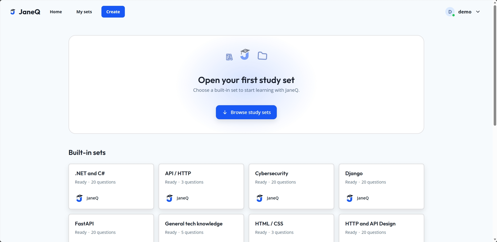
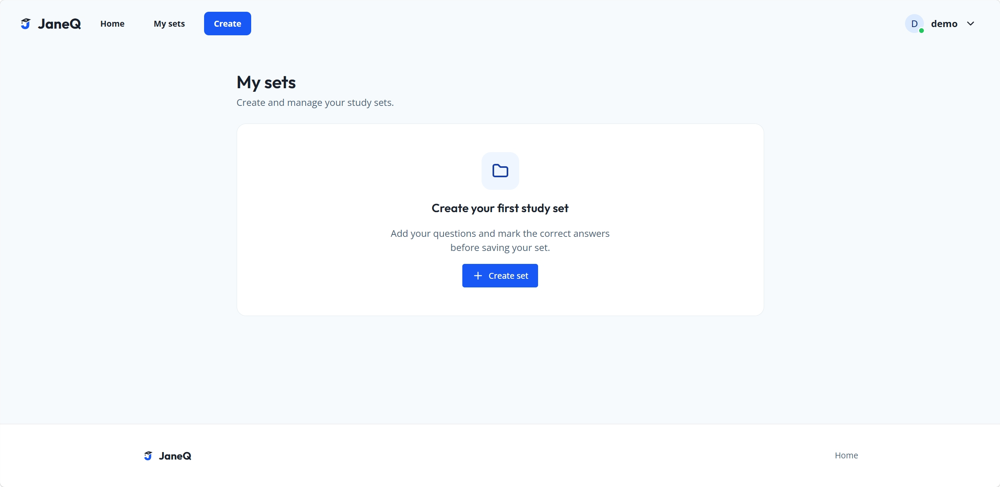
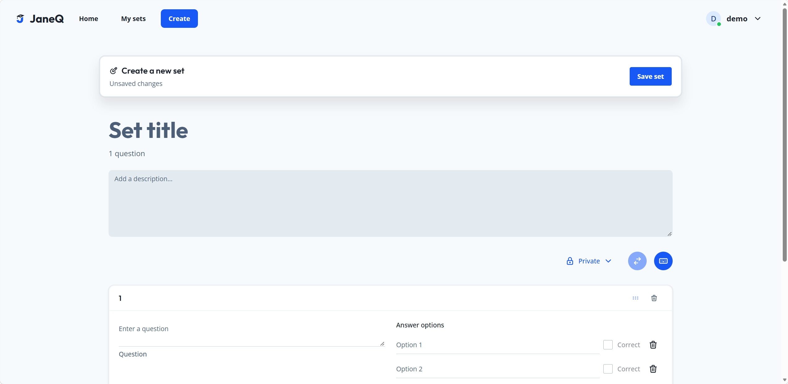

<p align="center">
  
</p>

<h1 align="center">JaneQ</h1>

<p align="center">
  <strong>Practice technical interview questions at your own pace.</strong><br>
  Work through curated study sets, take a practice test, or write your own questions.
</p>

<p align="center">
  <a href="#features">Features</a> ·
  <a href="#create-your-own-study-set">Screenshots</a> ·
  <a href="#local-development">Quick start</a> ·
  <a href="#documentation">Documentation</a>
</p>



## Features

- **Browse 18 built-in study sets with 281 questions** across topics such as React, Python, SQL, HTTP, and cybersecurity. The catalog includes both single-answer and multiple-select questions. [Question bank](docs/features/builtin-sets.md)
- **Build mastery one question at a time.** Flip through a set’s flashcard preview, then switch to Learn for immediate feedback and saved progress. [Study Set and Learn](docs/features/learn.md)
- **Take a practice or timed test.** Jump between questions, submit for a score, and review or download the results. [Sample PDF report](docs/features/test-results.sample.pdf)
- **Create private study sets.** Write questions and answer choices, mark every correct option, and revisit your sets from **My sets**. [My sets and Create/Edit](docs/features/study-set-authoring.md)

## Create your own study set

| My sets | Study set editor |
| --- | --- |
| [](docs/readme/my-sets.png) | [](docs/readme/study-set-editor.png) |
| Open your private library and select **Create set**. | Add your questions and answer key, then select **Save set**. |

## Local development

Use Python 3.13 with [uv](https://docs.astral.sh/uv/getting-started/installation/) and Node.js 24 with npm. JaneQ uses React, TypeScript, and Chakra UI in the frontend, with FastAPI and SQLite in the backend.

```sh
git clone https://github.com/ngxtm/JaneQ.git
cd JaneQ
```

### 1. Start the backend

From the repository root, install the locked dependencies and generate a session secret.

```sh
cd backend
uv sync --locked
uv run --locked python -c "import secrets; print(secrets.token_urlsafe(32))"
```

For first-time setup, copy [`backend/.env.example`](backend/.env.example) to `backend/.env`. Keep `JANEQ_DEMO_USERNAME=demo` or choose a username, set `JANEQ_DEMO_PASSWORD` to a password of your choice, and paste the generated value into `JANEQ_SESSION_SECRET`.

From `backend/`, start FastAPI on port 8000.

```sh
uv run --locked --env-file .env fastapi dev
```

### 2. Start the frontend

Open a second terminal at the repository root and start Vite.

```sh
cd frontend
npm ci
npm run dev
```

### 3. Sign in and open a study set

Sign in with the credentials from `backend/.env`, open a built-in set, and select **Learn** or **Test**. [Open JaneQ](http://127.0.0.1:5173/)

Vite proxies `/api` to FastAPI on port 8000. The proxied health endpoint should return `{"status":"ok"}`. [Health check](http://127.0.0.1:5173/api/health) · [Interactive API reference](http://127.0.0.1:8000/docs)

JaneQ seeds `backend/data/janeq-mvp.sqlite3` on first startup. Use `JANEQ_DB_PATH` to start with a separate SQLite file. Set `JANEQ_COOKIE_SECURE=true` when serving JaneQ over HTTPS. In a Git checkout, **Download PDF** saves a second copy under `output/pdf/test-results/`. Set `JANEQ_PDF_EXPORT_DIR` to use a different directory. [Database setup and upgrades](docs/database.md#built-in-data-and-startup) · [PDF export](docs/features/test-results.md#pdf-archive)

## Documentation

| Area | Guides |
| --- | --- |
| Library | [Sign in and Home](docs/features/login-home.md) · [Account registration plan](docs/features/account-registration.md) · [Built-in study sets](docs/features/builtin-sets.md) · [Missing pages and sets](docs/features/login-home.md#page-and-study-set-not-found) |
| Study modes | [Study Set and Learn](docs/features/learn.md) · [Study set URLs and preview loading](docs/features/learn.md#study-set-urls-and-preview-loading) · [Test, Results, and PDF export](docs/features/test-results.md) |
| Authoring | [My sets and Create/Edit](docs/features/study-set-authoring.md) |
| Implementation | [Database reference](docs/database.md) · [Frontend UI guide](docs/frontend.md) · [Branding](docs/features/branding.md) |

## Deployment

Deploy JaneQ with Docker Compose and Dokploy. [Dokploy deployment guide](docs/features/deploy-dokploy.md)

## Frontend checks

Run from `frontend/`.

```sh
npm run lint
npm run build
```
