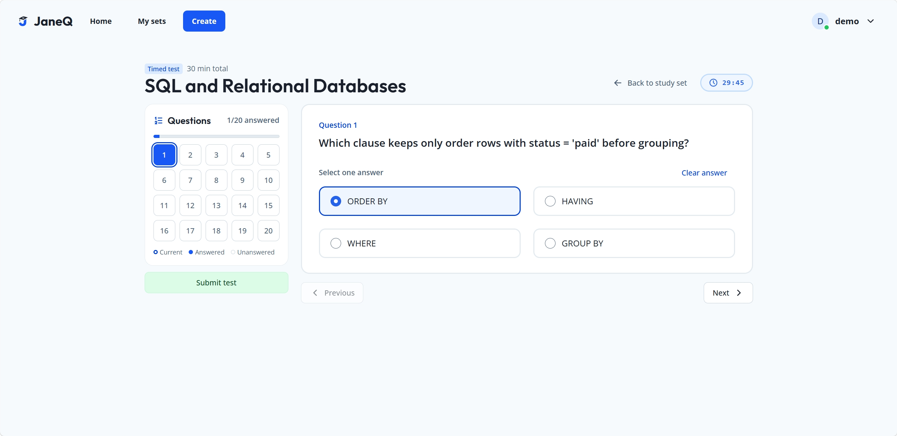

# Test, Results, and PDF download

## Run the flow

Use the [local development setup](../../README.md#local-development). Set `JANEQ_DB_PATH` to a fresh, disposable SQLite path before starting FastAPI. Start Vite, open [JaneQ](http://127.0.0.1:5173/), and sign in with the configured demo account.

1. From **Home**, open **HTML / CSS**, select **Test**, then start in **No time limit** mode. The direct route uses the set UUID. [HTML / CSS Test](http://127.0.0.1:5173/e50a062a-6abc-50be-b0ab-28452a4ce1eb/test)
2. Select `<ul>`, `background-color: navy`, and **The img element's alt attribute** on questions 1, 2, and 3. Use the numbered navigator or **Previous** and **Next** to move. Each question with a selection increases the counter once, even with several checked options.
3. Submit and check **Your results**. The score is **2 / 3 (67%)**, with question 2 marked incorrect. The review labels each selected option and each correct answer.
4. Select **Download PDF** and open `html-css-test-results.pdf`. Verify the score, all three question reviews, signed-in username, and submission time. In a Git checkout, also check for a matching file in `output/pdf/test-results/`. **New test** loads a fresh paper. **Back** returns to the Study Set. [PDF downloaded during mobile review](test-results.sample.pdf)

The exported filename uses the set title. After the UUID upgrade, submitting HTML / CSS and selecting **Download PDF** still produced a PDF blob named `html-css-test-results.pdf` in Chromium at 390 px.

**Pass · Chromium at 360 px.** Submitting the three choices above displayed 2 / 3 in Results, and **Download PDF** generated a PDF blob in the built app.

| Question | Selected option | Correct option | Outcome |
| --- | --- | --- | --- |
| `q15` | `q15-a` · `<ul>` | `q15-a` · `<ul>` | Correct |
| `q16` | `q16-a` · `background-color: navy` | `q16-c` · `color: navy` | Incorrect |
| `q24` | `q24-a` · alt attribute | `q24-a` · alt attribute | Correct |

Results stay on the Test route in the current browser view. Reloading a practice test clears its local selections. Reloading a timed test in the same tab recovers the saved paper, selections, and deadline or displays its saved result, even if the source set becomes Draft or is deleted. Opening **Test** from the overview starts a fresh attempt. The backend saves completed attempts and exposes them through Test history. Results and the PDF share the percentage and option labels derived from the grading response. Each **Download PDF** click starts a Web Worker that loads React PDF and generates the file locally. If the worker cannot load or render the report, the inline error leaves the existing Results ready for another click. The sample uses the seeded catalog and a disposable demo account. [Shared review data](../../frontend/src/features/test/result-review.ts)

For a timed run, select **Timed test** in the mode picker. This SQL example shows the question navigator and the remaining time in a 30-minute test.



## PDF archive

The tracked [sample report](test-results.sample.pdf) is the repository's assignment export. When running from a Git checkout, each click on **Download PDF** also saves the generated report under `output/pdf/test-results/<attempt-id>.pdf`. Downloading again replaces the saved copy for that attempt. Git ignores the runtime archive.

The browser sends the PDF bytes through the shared Axios client to `PUT /api/test-attempts/{attempt_id}/pdf` as `application/pdf`. The route requires a signed session and a completed attempt owned by that account. The backend bounds the upload to 16 MB and parses the PDF structure before atomically replacing the archive file. It returns `400` for an invalid, encrypted, or pageless PDF and `{"saved":true}` after saving. The browser starts the download after the archive request succeeds. If the archive is unavailable, the browser shows an inline message and **Download PDF** can retry. If the session expires, JaneQ opens sign-in and returns to the saved result after authentication. [OpenAPI](http://127.0.0.1:8000/docs)

Set `JANEQ_PDF_EXPORT_DIR` to override the directory. Relative overrides resolve from the repository root. Outside a checkout with no override, the route returns `{"saved":false}` and the browser download remains available.

## Report layout

The report uses A4 portrait, an 18 pt title, and 10.5–11 pt body text. The header repeats the JaneQ name and existing SVG mark as vector artwork. The first page shows the study set and score, **Submitted by**, and **Submitted at** with seconds and the browser's time zone offset. The footer gives the export date and page number. Question prompts stay in the original language and order. Each review uses the same English labels as Results and lists the selected and correct answers separately. Short reviews stay together across page breaks. Review dividers follow each question except the last, so continuation pages have only the header rule above the first review.

The template embeds static Open Sans fonts, including Vietnamese glyphs. It loads the Noto Sans TC fallback only when Open Sans lacks a glyph in a title, name, question, or answer. Noto Sans TC is a separate 4.3 MB asset. The report keeps mixed-script text selectable and shows an inline error if the available fonts cannot display a character.

Open Sans comes from commit `8e14d710`. The Noto Sans TC asset comes from the regional `NotoSansTC-VF.ttf` at commit `f8d1575`. To regenerate it, use FontTools `varLib.instancer` with `wght=400 --static`, then use `pyftsubset` with `--unicodes=* --layout-features=* --name-IDs=* --flavor=woff`. [Report template](../../frontend/src/features/test/result-pdf.worker.tsx) · [Open Sans license](../../frontend/src/features/test/fonts/OFL.txt) · [Noto Sans TC source](https://github.com/notofonts/noto-cjk/blob/f8d157532fbfaeda587e826d4cd5b21a49186f7c/Sans/Variable/TTF/Subset/NotoSansTC-VF.ttf) · [Noto license](../../frontend/src/features/test/fonts/NotoSansTC-OFL.txt)

## Test and Results design

The mode picker defaults to **No time limit**. Practice shows progress and keeps the question navigator available throughout the paper. **Timed test** adds one countdown for the whole paper. The slider selects 1–120 minutes and defaults to 30. Custom hours and minutes allow a total of 1 minute to 24 hours. The timer keeps running when a learner opens the submission dialog. [Mode picker](../../frontend/src/features/test/TestModeDialog.tsx)

Both modes use one question at a time. The question card shows the current number, such as **Question 2**. The question navigator sits on the left on desktop and above the question on narrow screens. Solid blue marks an answered question, and outlined white buttons mark unanswered questions. A dark blue ring with a white gap marks the current question and preserves its answer-state color. Each numbered button announces its answer state and moves focus to the selected prompt. Answers use Chakra radios or checkboxes in two columns on wider screens and one on narrow screens. The Test route keeps the library header and omits the library footer. [Test workspace](../../frontend/src/features/test/Test.tsx) · [Question navigator](../../frontend/src/features/test/QuestionNavigator.tsx)

For a single-choice question, **Clear answer** removes the selected radio and updates the navigator to unanswered. A multiple-choice question becomes unanswered when its last checkbox is cleared. Both modes include cleared questions in the partial-submission confirmation.

The **Submit test** button sits below the question navigator. Both submit buttons use a pale green fill and dark green text. Hover changes the fill to solid green with white text. A partial submission opens a confirmation with the unanswered count and question numbers. Focus starts on **Keep working**. **Submit anyway** grades blanks as zero. The workspace shows a static Boneyard placeholder after 200 ms and puts recoverable errors next to the affected content. [Submission confirmation](../../frontend/src/features/test/SubmitTestDialog.tsx)

Results keeps the paper cards for review and adds text labels alongside correct and incorrect marks. The summary includes a score ring and a breakdown by question type. It stacks on narrow screens and lets **Download PDF**, **New test**, and **Back** wrap. [Results component](../../frontend/src/features/test/Results.tsx)

## API and storage

Use the generated [Swagger UI](http://127.0.0.1:8000/docs) or [OpenAPI JSON](http://127.0.0.1:8000/openapi.json). Both calls use the signed `janeq_session` cookie and go through the [shared Axios client](../../frontend/src/http.ts). The [feature client](../../frontend/src/features/test/api.ts) validates the response before rendering. A `401` returns the app to sign-in.

| Request | Contract |
| --- | --- |
| `GET /api/study-sets/{set_id}/test` | Opening Test loads `set_id`, `title`, `revision`, and ordered `questions`. Each question has `id`, `prompt`, `options` containing `id` and `text`, and a `multiple` boolean. |
| `POST /api/study-sets/{set_id}/test` | Submit the paper's integer `revision` and one `{question_id, selected_ids}` entry per question. For a confirmed partial submission, send `allow_unanswered: true` and an empty list for each blank question. The response includes `attempt_id`, `mode`, `score`, `total`, graded questions, the signed-in `submitted_by`, and UTC `submitted_at`. Supply an optional `submission_id` UUID and reuse it on retries of the same submission. |

For the sample, send `revision: 1` and selections `["q15-a"]`, `["q16-a"]`, and `["q24-a"]` on their corresponding questions. The server checks for missing, unknown, or duplicate question IDs, unconfirmed blank answers, duplicate selections, choices from another question, and extra choices on single-answer questions. Invalid submissions return `422`. A question earns one point only when the selected and correct ID sets match exactly. The server returns questions and selected IDs in catalog order for review and export.

Both calls return `404` for a missing set and `409` with `detail.code: "draft"` and `detail.remaining_questions` for a Draft set. A Draft set with zero questions reports zero remaining and the UI asks the learner to add a configured question. A stale Ready submission returns `409` with `detail.code: "revision_changed"`. **Open a new test** clears the old choices and requests the current paper. If the browser cannot confirm a practice submission, it retains and locks the submitted choices. **Retry submission** replays the original payload and key to recover the result.

The [Test router](../../backend/app/test.py) checks readiness and revision with the shared [question bank reader](../../backend/app/question_bank.py). A successful submission saves the result before responding. Replaying a `submission_id` with the same set reference, revision, and selections returns the saved result, including after the set has been edited or deleted. Using the same key with different input returns `409` with `detail.code: "submission_id_reused"`. Requests without a key each create a new attempt. [Database reference](../database.md#test-attempts)

### Test history API

Sign in and use the session cookie for both routes. `GET /api/test-attempts` returns completed attempts newest first, with `limit` from 1 to 100 (default 20). The study set overview requests `set_id` and `limit=3` to filter the attempts before pagination. Existing set IDs and their legacy aliases refer to the same history. Pass `next_before` as `before` with the same filter for the next page. `GET /api/test-attempts/{attempt_id}` returns the complete saved result. A missing attempt or cursor, including one outside the account or the requested set, returns `404`. Unsigned requests return `401`. [History router](../../backend/app/test_history.py) · [OpenAPI](http://127.0.0.1:8000/docs)

History uses a table on desktop and linked cards on narrow screens. A static Boneyard capture of each layout appears after 200 ms. The result route uses a capture of the score summary while the saved result loads. **Load more** keeps the current rows visible and offers **Try again** if the next page fails.

### Timed Test API

The browser starts a whole-paper attempt with the signed session cookie. The attempt snapshots the ordered questions and answer keys at the current revision. Active responses omit answer keys.

| Request | Contract |
| --- | --- |
| `POST /api/study-sets/{set_id}/timed-test` | Send a UUID `start_id` and integer `duration_minutes` from 1 to 1440. The response has `status: "paper"`, the paper, `attempt_id`, `server_now`, `deadline_at`, and `answers` and `answer_versions` maps keyed by question ID. Replay the same key to resume. A reused key for a different set or a new attempt on a Draft set returns `409`. |
| `GET /api/test-attempts/{attempt_id}/state` | Read the paper and saved answers using the original deadline. Once graded, both the state and start routes return `status: "completed"` and the saved `result`. |
| `PUT /api/test-attempts/{attempt_id}/answer` | Send `question_id`, `selected_ids`, and `expected_version` (zero for a question with no recorded version). The browser also sends a `write_id` UUID. An empty list clears the answer. A successful save increments the version and returns JSON `null`. A stale version returns `409 answer_version_changed` with the saved `version`, `selected_ids`, and the saved `write_id` when present. Invalid answers return `422`. The server checks the time it received the answer before waiting for SQLite. A request received at or after the deadline returns the graded result. |
| `POST /api/test-attempts/{attempt_id}/finish` | Grade the saved answers and return the result. The browser waits for confirmed saves before a manual submission. At zero it waits for any in-flight save to settle or time out, then sends `only_if_expired=true`. If the server deadline has not passed, `409` with `time_remaining` and `server_now` resynchronizes the clock. Retrying a finished attempt returns its saved result. |

The browser estimates the deadline against its monotonic clock using the request round trip. The server makes the final expiry decision. Save and finish requests have a five-second timeout. After a failed save, the question stays pending until the current choice is reconciled with the server. The saved write UUID lets the browser recognize a lost reply to its own request. For a competing edit with different choices, the learner sees both answers and chooses **Use saved answer** or **Save my answer**. At expiry the test grades the saved answers. A blank question scores zero and gets `timed_out: true` when the deadline has passed. The result enters history after grading. Attempt access is scoped to the signed-in account. Sequential API clients can still start with `time_per_question` (10–600 seconds, default 60) and use `/advance` with the current question. Completed legacy results with unknown timing can also replay the final `/advance` response. [Timed router](../../backend/app/timed_test.py) · [OpenAPI](http://127.0.0.1:8000/docs) · [Database reference](../database.md#test-attempts)

## Reproduce failure checks

Use the disposable database from setup. Before changing it, open the HTML / CSS paper at revision 1 and answer all three questions. Then apply the following SQL to that database.

```sql
BEGIN;
UPDATE answer_options SET is_correct = 1 WHERE id = 'q15-b';
UPDATE study_sets SET revision = revision + 1 WHERE legacy_id = 'html-css';
COMMIT;
```

Submit the open paper to exercise the revision conflict. Select **Open a new test** and use the checkboxes on question 1. Try both `<ul>` and `<ol>`, then use **New test** to try only `<ul>`. To make the set Draft, clear both keys for question 1 and refresh the Study Set.

```sql
BEGIN;
UPDATE answer_options SET is_correct = 0 WHERE question_id = 'q15';
UPDATE study_sets SET revision = revision + 1 WHERE legacy_id = 'html-css';
COMMIT;
```

## Acceptance checks

Browser checks used Chromium with Vite, FastAPI, and disposable SQLite databases at 1440 and 360 px. The PDF checks carry forward from the earlier export milestones.

| Check | Reproduce and expect | Observed |
| --- | --- | --- |
| Navigator and theme | Open **Test**, select a choice on question 1, then jump to question 2. Check the blue ring and **Current** legend marker, the **Question 2** label, and keyboard focus. | Pass · Chromium at 1440 and 360 px. The white question 2 button had a blue ring matching the legend. The card read **Question 2**, and pressing Enter on the numbered button moved focus to the new prompt. |
| Submit button colors | Hover **Submit test** at 1440 px. Open the partial submission dialog at 360 px and check **Submit anyway**. | Pass · Chromium. The button changed from pale green with dark green text to solid green with white text. The confirmation used the same pale green at 360 px. |
| Confirm a partial submission | With one answer selected, submit. Check the count and question numbers. Dismiss and reopen, then confirm. | Pass · Chromium and API. At both widths, the dialog listed the two unanswered questions. Escape restored focus to **Submit test** on desktop. **Keep working** retained the selection on mobile. Confirming a partial practice or timed test produced a score of 1/3 and marked the blanks **Unanswered**. The dialog fit 360 px and skipped animation with reduced motion. |
| Clear a single answer | Select a radio in practice mode, tab to **Clear answer**, and press Enter at 360 px. | Pass · Chromium. The radio cleared, the answered count returned to zero, and keyboard focus stayed on **Clear answer**. The layout fit without horizontal overflow. |
| Reconcile a lost save and reject stale writes | Let the server save an answer, discard its response, then clear the answer and retry. Replay the original write after the clear. | Pass · Chromium, API, and SQLite. The confirmation waited for sync. Retrying cleared both the single-choice and multiple-choice answers. A delayed write with the old version returned `409`, and the cleared version survived reopening the database. |
| Resume independently of the source set | Start a timed test and save an answer. Make the source set Draft, reload, then delete it and reload again. | Pass · Chromium, API, and SQLite. Both reloads restored the saved question and answer at the original deadline. The deleted set's attempt still graded 1/1. |
| Whole-paper timing and recovery | Use the slider to start a one-minute attempt, answer a question, reload, and wait for time to expire. Repeat with the submit dialog open. Start another attempt with 2 hours and 15 minutes. Block the first answer save, then restore it and retry. | Pass · Chromium, API, and SQLite. Reloading kept the original deadline and answer. At zero the one-minute attempt showed 1/3 with two timed-out questions, including when the submit dialog was open. Custom entry showed a 2:15:00 countdown. The save retry retained the choice and allowed completion. |
| Workspace loading | Delay the practice paper response by 1.8 seconds at 360 px. Expect the heading immediately, followed by the static workspace skeleton and the real paper. | Pass · Chromium. The skeleton appeared during the delay, and the real workspace replaced it at 360 px without horizontal overflow. |
| Deadline and SQLite contention | Hold the SQLite write lock until the test clock reaches the deadline while a valid answer is waiting. Also call automatic finish before the deadline, then retry at the deadline. | Pass · API and SQLite. The pre-deadline answer counted. Automatic finish returned `409 time_remaining` early and returned a result at the deadline. |
| Delayed clock and stalled save | Delay the browser's start response for four seconds on a one-minute test. Save one answer, then stall another answer request with two to three seconds remaining. | Pass · Chromium and API. The initial timer showed 0:58, accounting for the delayed response. Auto-submit started about five seconds after the stalled request began and graded the saved answer for 1/3. |
| Practice replay after a lost reply | Let the server accept a partial submission, then simulate a connection error before the browser handles the response. Select **Retry submission**. | Pass · Chromium and API. The submitted choices stayed visible and locked. The retry sent the same payload and key and recovered the original 1/3 result. |
| History filter, links, and retry | Submit a test in one set, then add 20 newer attempts in another. Open the first set, open **View all history** under a non-root base path, delay the list and result responses, and fail the first **Load more** request. | Pass · Chromium, API, and SQLite. The first set still showed its attempts. History and Results used `/qa/` links, supported Enter, and kept the shared header mounted. Static placeholders matched the desktop table, mobile cards, and mobile score summary. The failed page kept 20 rows and **Try again** loaded the next page. |
| History initial error and empty state | Block the first history request, then retry with an empty page response. | Pass · Chromium. The initial error exposed **Try again**. The empty page showed **No test attempts yet** and linked back to the configured base path. |
| Ready flow and PDF | Complete the sample from Home at both widths, then download from Results. Expect 2/3 and matching question reviews. | Pass · Chromium and PDF. Both downloads showed 2/3. PDF text matched the graded prompts, correctness, selections, correct answers, demo username, and submission timestamp. |
| PDF archive ordering and reauthentication | Delay the archive and navigate back before it completes. Return to the result and download again. Then clear the session and repeat the export. | Pass · Chromium and API at 360 px. No download began when navigation canceled the pending archive. A normal download began after the archive returned success. An expired session opened sign-in and restored the saved result afterward. The API rejects an invalid PDF before replacing a valid archive. |
| Competing timed edits | Save one answer through a second client, then select a different answer on a stale screen. Try both resolution actions. Separately drop the response to the current client's own save and clear the selection. | Pass · Chromium and API at 360 px. No overwrite occurred without confirmation. **Use saved answer** restored the server choice and **Save my answer** saved the local choice. Retrying the client's own lost reply still cleared the answer. |
| Report layout | Download the HTML / CSS sample and the 20-question .NET and C# report. Render all pages and check the headings, logo, font, and footer. | Pass · Chromium and PDF on the production build. At 360 px the HTML / CSS report was one A4 page with 2/3. At 1440 px the .NET report was four A4 pages with 4/20. Extracted text matched the grading response for every prompt and review. The vector logo and page numbering appeared on every page. |
| Report dividers | Complete the 20-question .NET and C# test and select **Download PDF**. Expect one rule above the first review on each continuation page and one rule between adjacent reviews. Repeat with the one-page HTML / CSS report and check the rule under **Question review**. | Pass · Chromium and PDF. Captured the generated PDFs at 1440 px and 360 px, respectively. The four-page report had one rule above the first review on pages 2–4, and both reports retained the first-page review heading rule, separators between questions, and page numbering. |
| PDF retry | In Chromium, make the first PDF Blob URL creation throw, then select **Download PDF** again. | Pass · Chromium. Results displayed the inline error, retained the score, and downloaded the PDF on retry. |
| Worker retry | On the production build, block `/assets/result-pdf.worker-*.js`, click **Download PDF**, unblock the script, then click again on the same screen. Repeat a normal download through the Vite dev server. | Pass · Chromium and PDF at 360 px. Two worker requests were observed in the production build. The first failed and the second downloaded the report with the original score and submission time. The dev server also downloaded the report. |
| Report glyph coverage | Sign in as a disposable `王小明 Nguyễn` account and export. Extract PDF text and compare the name to `submitted_by`. Send a worker test request with an unsupported character such as `𐰀`. | Pass · Chromium and PDF. The mixed-script name rendered and extracted exactly. The worker returned the unsupported-text result for `𐰀` and produced no PDF. |
| Responsive layout and navigation | Inspect the paper and Results at both widths. Use **Back** and **New test**. | Pass · Chromium. The paper used two columns at 1440 px and one at 360 px, with no horizontal overflow. The score ring measured 140 px and 100 px respectively. Back returned to the overview and New test cleared progress. |
| Keyboard and reduced motion | Use arrows on radios and Tab and Space on checkboxes. Enable reduced motion before submitting. | Pass · Chromium. Both controls had a visible 2 px focus outline. Results moved focus to its heading. The score ring had a 0 s transition under reduced motion. |
| Missing, duplicate, or invalid selections | Send a standard submission that omits a question or sends an empty selection without confirmation. Exercise duplicate IDs, foreign choices, and multiple IDs on a radio question. | Pass · API. Invalid submissions return `422`. Confirmed blanks are stored with empty selections and earn zero. |
| Revision and exact-set grading | Apply the first SQL fixture while a paper is open. Submit the stale paper, open the new one, and test complete and partial selections. | Pass · Chromium and API. The stale paper offered **Open a new test**. Both checked options earned the point. A partial selection lost it at 360 px. The API also verified that an extra option loses the point. |
| Incomplete data and session | Apply the second fixture to the built-in set and navigate directly to its Test URL. Run the unsigned GET and POST tests. | Pass · API. The Test API returned 409 for the incomplete fixture, and both unsigned calls returned 401. The earlier browser run confirmed the direct Test route displayed no questions. Existing custom Draft links now open the editor. |
| Loading and network retry | Delay the paper request, then let it finish. Abort a load and retry. Abort a submit after all questions are answered, then restore the request and retry. | Pass · Chromium in the earlier Test milestone. The Test header stayed visible, the skeleton appeared during the delayed response, and both retries succeeded. |
| Saved history | Submit the HTML / CSS sample with a `submission_id`, read it through history, then replay it. Delete its source set in a disposable database and restart. Read the result as the original account and as another account. | Pass · API and SQLite. The keyed replay kept the same attempt and score. After restart the original account read the full snapshot. The other account received `404`. |
| Timed grading | Run the timed backend tests below. Start HTML / CSS, submit a correct multi-select just before the first deadline, submit an incorrect answer, and submit the correct selection at the last deadline. Change the source set after starting. | Pass · API. The original paper was graded `1/3`, with the last question marked `timed_out`. History returned the same result. |
| Timed resume and retry | Advance the test clock past the first deadline, reopen the same database through a fresh app, and send two overlapping advances for the expired question. | Pass · API and SQLite. The saved deadline survived reopening. Both advances returned question 2 with the same new deadline. Another account received `404`. |
| Backend, lint, and build | Run the checks below from the indicated directories. | Pass · CLI. All 40 backend tests passed. Frontend lint and production build passed. |

From `backend/`:

```powershell
uv run --locked --no-sync python -m unittest discover -s tests -v
```

From `frontend/`:

```powershell
npm run lint
npm run build
```
